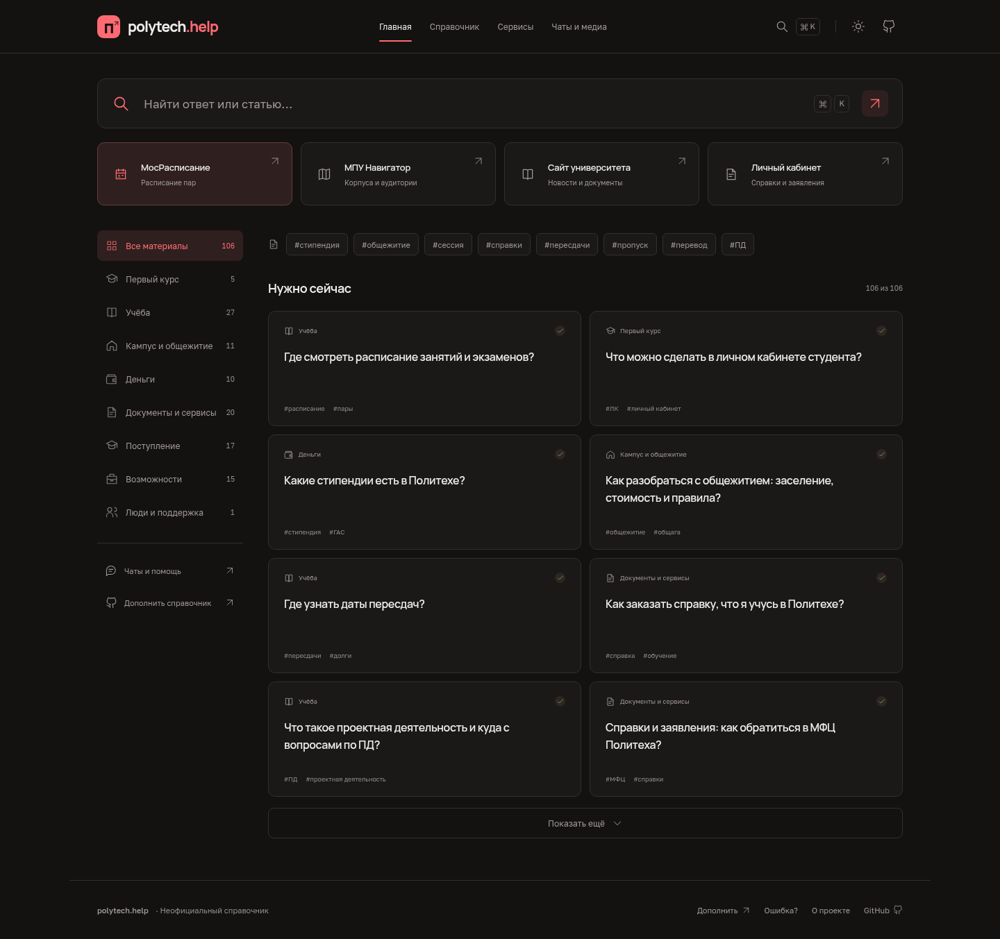

<div align="center">

# polytech.help ↗

**Всё нужное студенту — в одном месте.**

Открытый справочник студентов Московского Политеха.

[Сайт](https://polytech.help) · [Добавить ответ](CONTRIBUTING.md) · [Сообщить об ошибке](https://github.com/set-night/mospolytech-help/issues/new/choose)

[](https://github.com/set-night/mospolytech-help/actions/workflows/ci.yml)
[](https://github.com/set-night/mospolytech-help/actions/workflows/deploy.yml)
[](LICENSE)

</div>



106 статей с источниками. Поиск прямо на главной, категории, теги и полезные сервисы. Тёмная тема по умолчанию, светлая — по переключателю. `Ctrl/⌘ K` или `/` — поиск; `↑ ↓` — выбрать; `Enter` — открыть; `Esc` — закрыть.

**Astro 7 · TypeScript strict · Markdown · Pagefind · Cloudflare Pages**

## Дополнить справочник

На странице статьи нажми **Исправить на GitHub**. Для нового вопроса скопируй [шаблон](docs/article-template.md) в `src/content/articles/` и открой PR. Подробности — в [CONTRIBUTING.md](CONTRIBUTING.md). Ключи публикации участникам не нужны.

## Запуск

Node.js 24 LTS:

```sh
npm ci
npm run dev
```

Поиск работает по собранному сайту:

```sh
npm run build
npm run preview
```

Проверить проект: `npm run verify`. Браузерные тесты: `npm test` после `npx playwright install chromium`. Форматирование: `npm run format`.

[Структура проекта и работа над интерфейсом](CONTRIBUTING.md#изменить-сайт) · [Документация](docs/README.md)

## Источники

Вдохновились идеей из [поста «Подслушано»](https://t.me/mospolyoverheard/2542).

Материалы [официального сайта](https://mospolytech.ru/), [«Привет, Московский Политех»](https://privet-mospolytech-student-guide.lavrushec.chatgpt.site/) и [«Политех. Выжить и выпуститься»](https://faq.rozb.pw/). Снимки, покрытие импорта и ограничения — в [docs/sources](docs/sources/README.md). 50 совпадающих вопросов объединены с сохранением ссылок.

Проект неофициальный. Импортированные ответы требуют редакторской проверки — статус виден в статье. MIT распространяется на код; права на импортированные материалы остаются у авторов.
